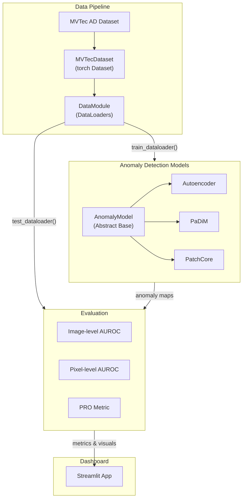

# AnomalyScope AI

**Industrial Visual Anomaly Detection with PyTorch**

AnomalyScope AI is a modular framework for unsupervised anomaly detection and localization
in industrial inspection images. It implements state-of-the-art methods — including PaDiM
and PatchCore — evaluated on the MVTec Anomaly Detection (AD) benchmark, and provides an
interactive Streamlit dashboard for visual analysis.

---

## Architecture



---

## Features

- **Multiple Detection Methods** — Autoencoder (reconstruction-based), PaDiM (embedding
  distribution), and PatchCore (memory bank with coreset subsampling).
- **Pixel-Level Localization** — Generates dense anomaly heatmaps pinpointing defect regions.
- **Standard Evaluation** — Image-level AUROC, pixel-level AUROC, and Per-Region Overlap (PRO).
- **Interactive Dashboard** — Streamlit-based UI for browsing predictions, overlaying heatmaps,
  and comparing models side by side.
- **Reproducible Configs** — YAML-driven configuration with deep-merge support and CLI overrides.
- **Windows-Friendly** — Defaults to `num_workers=0` and auto-detects CPU/GPU.

---

## Installation

### 1. Create a virtual environment

```bash
python -m venv .venv
# Windows
.venv\Scripts\activate
# Linux / macOS
source .venv/bin/activate
```

### 2. Install PyTorch (CPU-only)

```bash
pip install torch torchvision --index-url https://download.pytorch.org/whl/cpu
```

> For GPU support, see the [PyTorch installation guide](https://pytorch.org/get-started/locally/).

### 3. Install remaining dependencies

```bash
pip install -r requirements.txt
```

---

## Dataset Setup

AnomalyScope AI uses the **MVTec Anomaly Detection (AD)** dataset.

1. Visit <https://www.mvtec.com/company/research/datasets/mvtec-ad> and download the dataset
   (requires accepting the license agreement).
2. Extract the archive into the `data/` directory:

```bash
python scripts/download_dataset.py --output-dir ./data
```

Expected directory structure:

```
data/
└── mvtec_anomaly_detection/
    ├── bottle/
    │   ├── train/
    │   │   └── good/
    │   ├── test/
    │   │   ├── good/
    │   │   ├── broken_large/
    │   │   ├── broken_small/
    │   │   └── contamination/
    │   └── ground_truth/
    │       ├── broken_large/
    │       ├── broken_small/
    │       └── contamination/
    └── hazelnut/
        └── ...
```

---

## Usage

### Train a model

```bash
python -m anomalyscope.train --config configs/padim.yaml --category bottle
```

### Evaluate a model

```bash
python -m anomalyscope.evaluate --config configs/padim.yaml --category bottle
```

### Launch the Streamlit dashboard

```bash
streamlit run anomalyscope/dashboard/app.py
```

---

## Project Structure

```
AnomalyScope-AI/
├── anomalyscope/
│   ├── __init__.py
│   ├── data/
│   │   ├── __init__.py
│   │   ├── dataset.py          # MVTecDataset
│   │   ├── datamodule.py       # DataModule (DataLoaders)
│   │   └── transforms.py       # Image transform pipelines
│   ├── models/
│   │   ├── __init__.py          # Model factory
│   │   ├── base.py              # AnomalyModel ABC
│   │   ├── autoencoder.py       # Reconstruction-based model
│   │   ├── padim.py             # PaDiM implementation
│   │   └── patchcore.py         # PatchCore implementation
│   ├── evaluation/
│   │   └── __init__.py
│   ├── dashboard/
│   │   ├── __init__.py
│   │   ├── app.py               # Streamlit entry point
│   │   └── components/
│   │       └── __init__.py
│   └── utils/
│       ├── __init__.py
│       ├── config.py            # YAML config loader
│       ├── device.py            # Device selection helper
│       └── io.py                # Checkpoint & CSV I/O
├── configs/
│   ├── default.yaml
│   ├── autoencoder.yaml
│   ├── padim.yaml
│   └── patchcore.yaml
├── scripts/
│   └── download_dataset.py
├── tests/
├── pyproject.toml
├── requirements.txt
├── LICENSE
├── THIRD_PARTY_NOTICES.md
└── README.md
```

---

## Supported Categories

| Category   | # Train | # Test (Good) | # Test (Defective) | Defect Types                                 |
|------------|---------|---------------|---------------------|----------------------------------------------|
| Bottle     | 209     | 20            | 63                  | broken_large, broken_small, contamination    |
| Hazelnut   | 391     | 40            | 70                  | crack, cut, hole, print                      |

---

## Results

All experiments: CPU, seed 42, image size 256, 80/20 held-out calibration split,
threshold calibrated on normal validation scores (p99.5). Values below are the
actual saved results (the Streamlit dashboard reads these numbers dynamically
from the result JSON files).

### Bottle (167 fit / 42 calibration / 83 test)

| Model       | Image AUROC | Pixel AUROC | AUPRO | Precision | Recall | F1     | Threshold |
|-------------|-------------|-------------|-------|-----------|--------|--------|-----------|
| PaDiM       | 0.9960      | 0.9831      | 0.9313| 0.9833    | 0.9365 | 0.9593 | 15.0620   |
| PatchCore   | 1.0000      | 0.9871      | 0.9186| 1.0000    | 1.0000 | 1.0000 | 15.8087   |
| Autoencoder | 0.7651      | 0.6294      | 0.4438| 1.0000    | 0.5238 | 0.6875 | 0.6452    |

### Hazelnut (313 fit / 78 calibration / 110 test)

| Model       | Image AUROC | Pixel AUROC | AUPRO | Precision | Recall | F1     | Threshold |
|-------------|-------------|-------------|-------|-----------|--------|--------|-----------|
| PaDiM       | 0.8493      | 0.9827      | 0.8515| 0.8769    | 0.8143 | 0.8444 | 16.6238   |
| PatchCore   | 1.0000      | 0.9885      | 0.8627| 1.0000    | 1.0000 | 1.0000 | 19.7732   |
| Autoencoder | 0.9754      | 0.9788      | 0.8144| 1.0000    | 0.7286 | 0.8430 | 0.1950    |

> **Reproducibility note (PatchCore).** PatchCore was implemented in two stages.
> The original Bottle experiment used shuffled data loading, while the later
> memory-efficient two-pass implementation introduced deterministic ordering to
> ensure consistent feature extraction across both passes. The core algorithm,
> backbone, image size, projection dimension, and coreset ratio were preserved.
> This implementation detail is documented for reproducibility when interpreting
> results. See [docs/METHODOLOGY.md](docs/METHODOLOGY.md) for details.

These results are on a small benchmark subset and are not claimed to be
state-of-the-art or to match published numbers.

---

## License

This project is licensed under the **MIT License** — see [LICENSE](LICENSE) for details.

The MVTec AD dataset is licensed under CC BY-NC-SA 4.0. See
[THIRD_PARTY_NOTICES.md](THIRD_PARTY_NOTICES.md) for full attribution.

---

## Citation

If you use AnomalyScope AI in your research, please cite:

```bibtex
@software{anomalyscope2026,
  title  = {AnomalyScope AI: Industrial Visual Anomaly Detection},
  year   = {2026},
  url    = {https://github.com/anomalyscope-ai/AnomalyScope-AI}
}
```
